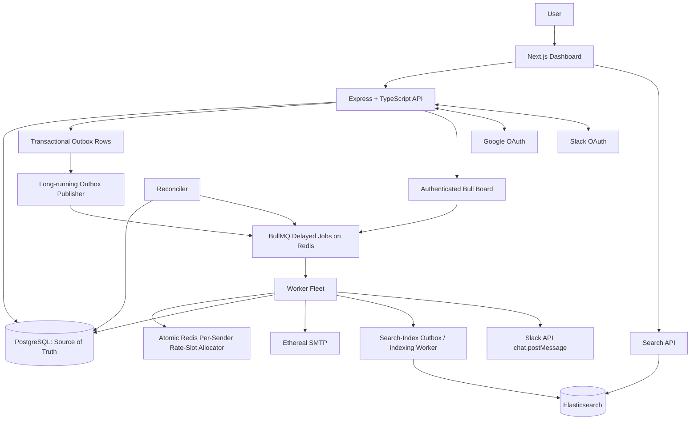

# ReachInbox Architecture Documentation

## Overview

ReachInbox is a full-stack email scheduling application built with a focus on reliability, observability, and production-grade infrastructure. The system allows authenticated users to import lead lists, create email campaigns, schedule emails with rate limiting, and track delivery status through a dashboard.

## Technology Stack

| Layer | Technology |
|-------|------------|
| **Backend API** | TypeScript, Node.js, Express.js |
| **Queue/Scheduling** | BullMQ + Redis (delayed jobs) |
| **Database** | PostgreSQL + Prisma ORM |
| **SMTP** | Nodemailer + Ethereal Email |
| **Search** | Elasticsearch |
| **Queue Dashboard** | Bull Board |
| **Frontend** | Next.js, React, TypeScript, Tailwind CSS |
| **Authentication** | Google OAuth 2.0 / OIDC |
| **Notifications** | Slack OAuth + Web API |
| **Infrastructure** | Docker Compose (local), Kubernetes-ready |

## System Architecture



## Component Responsibilities

### PostgreSQL (Source of Truth)
- Canonical email/campaign/sender/user state
- Durable outbox events for queue publishing and indexing
- OAuth connection records and audit metadata
- Idempotency keys to prevent duplicate scheduling

### Redis / BullMQ (Job Execution)
- Delayed-job timing (one job per recipient)
- Ready/active/completed/failed queue states
- Retries with exponential backoff
- Distributed rate-slot reservations via atomic Lua scripts
- Job locks and stalled-job recovery

### Worker Process (Independent)
- Performs actual SMTP delivery
- Independently deployable and horizontally scalable
- Chooses correct Ethereal transport by `senderId`
- Enforces rate limits via Redis allocator
- Updates PostgreSQL status and Elasticsearch index

### Outbox Publisher (Long-running)
- Bridges PostgreSQL commits to Redis
- Retries on Redis errors with bounded exponential backoff
- Uses `LISTEN/NOTIFY` for low-latency wake-up
- Recovery scan at startup and after reconnect
- At-least-once publishing with deterministic job IDs

### Reconciler
- Repairs divergence when queue data lost or outbox stuck
- Inspects PostgreSQL truth; skips `SENT`/`CANCELLED` records
- Safe concurrent claims with DB constraints
- Does not blindly resend delivered emails

### Elasticsearch (Search Index Only)
- Read/search index, never authoritative data store
- Indexes: emailId, userId, campaignId, senderId, recipient, subject, body, status, timestamps
- Authenticated, tenant-scoped search API
- Durable indexing via outbox/retry; ES outage never blocks SMTP

### Bull Board (Operational Visibility)
- Mounted at `/admin/queues` behind admin authorization
- Shows waiting, delayed, active, completed, failed, stalled states
- Uses same queue connection as producers/workers

## Data Flow

### Email Scheduling
1. User authenticates via Google OAuth
2. User uploads CSV/text, enters campaign details, selects sender
3. Frontend parses for preview; **backend re-validates every address**
4. API authenticates, verifies sender ownership
5. **Single PostgreSQL transaction**: create campaign (optional), one `ScheduledEmail` row per valid recipient, outbox events for job publishing and indexing
6. API returns `202 Accepted` after DB commit (Redis may be down)
5. Outbox publisher picks up events, adds delayed jobs to BullMQ with deterministic `jobId = email-${emailId}`

### Email Delivery
1. BullMQ job becomes eligible at `scheduledAt`
2. Worker loads email row from PostgreSQL
3. Checks status/cancellation; skips if `SENT`/`CANCELLED`
4. Atomically reserves sender rate-slot in Redis (Lua script):
   - Enforces `MIN_DELAY_BETWEEN_EMAILS_MS` across all workers
   - Enforces `MAX_EMAILS_PER_HOUR_PER_SENDER` in UTC fixed-hour windows
   - If limit reached, moves job to next available hour slot
5. Sends via sender's Ethereal SMTP transport
6. On success: persist `SENT` + timestamp + provider metadata
7. On permanent failure: persist `FAILED` + safe error code
8. On retryable failure: throw for BullMQ retry/backoff
9. Indexing worker asynchronously updates Elasticsearch

### Rate Limit Handling
- When hourly cap hit, job is **rescheduled** (not dropped/failed)
- Slack notification sent once per sender/hour window (idempotent)
- If Slack disconnected, email still reschedules safely
- Distinct senders have independent quotas

## Failure Modes & Recovery

| Failure Scenario | Mitigation |
|------------------|------------|
| Redis down during scheduling | DB transaction commits; outbox publisher retries until Redis recovers |
| Worker crashes after SMTP accept | DB idempotency key + deterministic job ID + status guard prevent duplicate sends |
| Redis data loss (AOF corruption) | Reconciler recreates missing jobs from nonterminal PostgreSQL records |
| Elasticsearch down | Indexing outbox retains events; SMTP succeeds; backfill on recovery |
| Multiple workers | Atomic Redis Lua allocator prevents rate-limit violations |
| API duplicate request | Unique `idempotencyKey` constraint in PostgreSQL |
| Process restart | Delayed jobs persist in Redis (with AOF); future jobs survive |

## SMTP Idempotency Caveat

**There is no universal exactly-once SMTP delivery guarantee.** The ambiguity window:
1. SMTP provider accepts message (250 OK)
2. Worker crashes before persisting `SENT` status

Mitigations implemented:
1. Unique DB `idempotencyKey` on schedule requests
2. Deterministic BullMQ job IDs (`email-${emailId}`)
3. Pre-send DB status check (skip `SENT`/`CANCELLED`)
3. Safe atomic DB transitions / lease mechanism
4. Persist attempt count and provider response metadata
5. Reconcile stuck `SENDING` records with lease timeout
6. Deterministic `Message-ID` header where possible
7. Document limitation honestly; avoid duplicate sends in normal flows

## Security

- All secrets in environment variables; never in source control
- Slack/SMTP tokens encrypted at rest (AES-256-GCM)
- Google OAuth state validation (CSRF protection)
- HttpOnly, Secure, SameSite cookies for sessions
- Bull Board restricted to admin users only
- All queries scoped to authenticated user/tenant
- No credentials exposed to frontend or logs

## Observability

- Structured JSON logs with request ID, job ID, email ID, sender ID, attempt
- Health endpoints: `/health/live` (liveness), `/health/ready` (readiness with dependency checks)
- Metrics: queue wait time, job duration, retry count, outbox lag, rate-limit hits, Slack delivery status, ES indexing lag
- Graceful shutdown with bounded timeouts

## Local Development

```bash
# Start infrastructure
pnpm run dev:infra

# Run migrations
pnpm run db:migrate

# Seed development data (Ethereal senders)
pnpm run db:seed

# Start all services
pnpm run dev
```

## Production Considerations

- **Redis**: Use managed Redis with replication, appropriate persistence, backups, monitoring. Single-node local Redis is not HA.
- **PostgreSQL**: Managed instance with PITR, read replicas for search API
- **Elasticsearch**: Managed cluster with snapshot lifecycle policies
- **Workers**: Horizontal scaling via Kubernetes Deployment / ECS Service
- **Secrets**: External secret manager (AWS Secrets Manager, HashiCorp Vault, etc.)
- **TLS**: Terminate at load balancer; trust proxy headers in Express